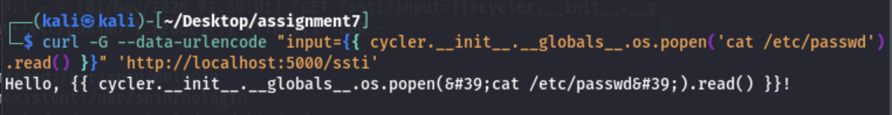
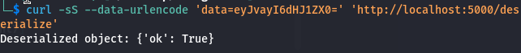
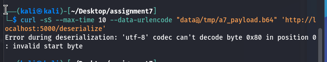

# Web vulnerabilities and remediation

**Source:** Assignment 7, Tasks 1–16. **Status:** Tasks 1–15 have recorded results. Task 16 contains proposed code-review fixes, not deployed changes.

I tested an intentionally vulnerable Docker lab, traced the unsafe operations in its source, and verified four focused patches against the original request paths.

## Investigation and fixes

| Tasks | Finding | Evidence and follow-up |
| --- | --- | --- |
| 1–3 | SQL injection through a query parameter. | sqlmap identified SQLite and two tables. Old user credentials failed after restart because setup regenerated them. Fresh query results and a successful login confirmed the new state. |
| 4–7 | Manual injection in login and profile operations. | The lab showed login bypass, a changed password verified by normal login, a numeric salary update from 10,000 to 20,000, and a deleted table confirmed by a later ordinary query error. |
| 8 | Interpolated lookup query. | Replaced it with a fixed query and bound parameter. A normal lookup worked, while the previous injected lookup returned no user. |
| 9–10 | IDOR in the user-data route. | A user-selected query parameter returned another account's record. The patch selected only the identity associated with the authenticated token. Repeating the same request returned the token owner's data. |
| 11–12 | SSTI through a dynamically constructed Jinja template. | The original route returned container file contents. A fixed template with an input variable rendered the former payload as text. |
| 13–14 | Executable pickle deserialization. | The lab received a shell callback and `id` reported root inside the container. Replacing pickle with JSON preserved a normal JSON request and rejected the old pickle bytes. |
| 15–16 | MCP file-read and Git command-injection flaws. | The tools returned an out-of-directory file and an injected user-ID result. I reviewed the source and proposed directory confinement and shell-free argument handling. Those proposed replacements were not installed. |

## Selected readback evidence

After the SSTI patch, the original expression was rendered literally instead of returning file contents:

After the deserialization patch, an ordinary JSON object still parsed:

The former pickle input was rejected:

These are original terminal captures from the assignment. The JSON response still reflects input into an HTML response, and the error is exposed to the client. Rejecting pickle addresses that execution path but does not establish complete output-encoding or error-handling safety.

## Code and limits

The [four route excerpts](../code/web-patches/README.md) preserve the patch scope and lab dependencies. In particular, the IDOR patch retains a pre-existing response-field typo and the course token design. It demonstrates the object-selection fix, not a complete authentication rewrite.

The [MCP review snippets](../code/mcp-review/README.md) retain vulnerable examples alongside proposed alternatives. A successful `id` ran as the backend's user in the MCP case. The separate deserialization shell was root inside a container. Neither observation establishes compromise of the Docker host.

**Skills demonstrated:** source-assisted testing, SQL and object authorization analysis, Flask/Jinja review, Docker verification, and before/after evidence.
