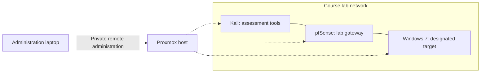

# Lab environment

The assignment setup used Kali Linux, a pfSense router, and a Windows 7 target. My reports document this environment running under Proxmox, with remote administration through a private Tailscale path. The handout described VirtualBox, so the hypervisor choice was an implementation difference in my setup.

The diagram describes roles, not a current live network inventory. Later exercises also used local Docker applications, SQLite databases, and intentionally vulnerable banking and MCP applications. Historical reports used private lab addresses. The portfolio omits management endpoints and credentials.

I have not claimed that every historical persistence mechanism was removed or that the environment was re-audited during portfolio preparation. The case studies describe the recorded experiments, not the present runtime state.

See the separate [home-lab build journal](https://github.com/RDMRock/home-cybersecurity-lab) for infrastructure documentation.
